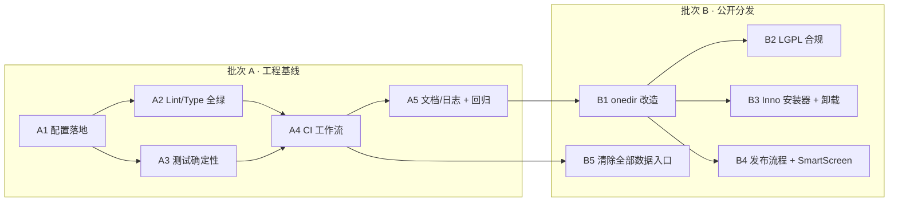

# Wallpace 工程化基线设计（成熟产品化 · 批次 3）

- **作者**：高见远（架构师）
- **日期**：2026-09-30
- **目标**：把 Wallpace 从"能跑的桌面工具"推向"可持续交付的成熟产品"，落地 CI / Lint / 类型 / 打包 / 版本 / 测试确定性基线
- **范围**：本文档仅为设计；**未改动 `src/`、`tests/` 任何文件**（唯一例外：创建隔离 venv 用于实测，见下）
- **禁止触碰**：根目录工程师上轮的临时产物（`_*.txt`）

---

## 0. 现状基线（team-lead 实测，采信）

| 指标 | 值 |
|---|---|
| 源码 | 6199 行 / 24 个 .py（`src/`） |
| 测试 | 3361 行 / 15 个文件 |
| 全量测试 | **239 passed / 3 skipped / 0 failed** |
| 已完成改造 | 4 项 P0 + 文件夹监听 + 20 余项优化 + #1 三步搬迁（ScanController / GalleryStrip / SettingsController 已抽出，window.py 1128 行） |
| TODO/FIXME 残留 | 无 |

---

## 1. 实测数据（本机隔离 venv 实跑，**非推断**）

实测环境（仅用于测量，不污染系统）：

```
C:/Programs/Python/Python313/python.exe -m venv --system-site-packages \
  C:/Users/靳浩祺/.workbuddy/binaries/python/envs/wallpace-dev
# PyPI 官方源超时，改用清华镜像成功安装
python.exe -m pip install ruff mypy -i https://pypi.tuna.tsinghua.edu.cn/simple
```

- **ruff 0.16.9**　·　**mypy 2.3.1 (compiled)**

### 1.1 ruff 违规量（`src` + `tests`）

> ⚠️ 注意：ruff 0.16 的**默认规则集是版本相关的宽集**（实测默认即 242 条，含 UP/I/DTZ/SIM/S/RUF 等），与旧版 "E4,E7,E9,F" 默认完全不同。**CI 必须显式 `select` 钉死规则集**，否则升级 ruff 会凭空变红。

| 规则集 | 违规数 | 可自动修 |
|---|---|---|
| 默认（版本相关，**不建议直接采用**） | 242 | 200 |
| `E4,E7,E9,F`（经典 pyflakes+pycodestyle） | 39 | 30 |
| `E4,E7,E9,F,I`（+ 导入排序，ll=100） | 60 | 46 |
| **拟定 day-1 集**：`E4,E7,E9,F,I,W,UP,B,C4,SIM,RUF`（ll=100，排除中文标点） | **~253** | **205** |
| 上述 + `PLR`（会引入 43 条 magic-value + 复杂度噪音） | ~308 | 205 |
| `RUF001,RUF002,RUF003`（**中文全角标点误报**） | **1601** | 0 |

**day-1 集按规则 Top 分布**：

| 规则 | 数量 | 可修 | 说明 |
|---|---|---|---|
| UP045 | 67 | ✅ | `Optional[X]` → `X | None` |
| UP006 | 49 | ✅ | `List/Dict` → `list/dict` |
| F401 | 31 | ✅ | 未使用导入 |
| UP035 | 28 | ⚠️unsafe | 弃用 typing 导入 |
| I001 | 19 | ⚠️unsafe | 导入未排序 |
| RUF100 | 13 | ✅ | 失效 noqa |
| SIM105 | 6 | ❌ | `try/except/pass` → `contextlib.suppress` |
| W605 | 5 | ✅ | 非法转义 |
| UP037 | 5 | ✅ | 引号注解 |
| E702/E722/SIM102/RUF012/B017/B008/RUF013/E402/SIM115/B904/F811/W291/F821/F841/B905 | 各 1–3 | 混合 | 需手改 |

**手改残留估计**：205 条 auto-fix 后，剩 **~47 条**需人工（SIM105×6、SIM102×3、E702×3、E722×2、RUF012×2 + 15 个单条；其中 **F821 undefined-name、F811 redefined-while-unused 是真问题，必修**）。

**行宽**：`>100` 仅 **6 行**、`>88` **31 行** → 取 `line-length = 100` 时 **E501 归零**（无需忽略）。

### 1.2 mypy 错误（`src`，24 文件）

| 命令 | 结果 |
|---|---|
| `mypy src --ignore-missing-imports` | **12 errors / 7 files** |
| `mypy src`（**不加** ignore-missing-imports） | **同样 12**（PySide6 自带 .pyi stub，无需忽略） |
| `mypy src --ignore-missing-imports --disallow-untyped-defs` | 38 |

**12 条错误明细**（可直接派工）：

| 文件:行 | 错误码 | 说明 |
|---|---|---|
| `settings.py:19` | var-annotated | `DEFAULT_CONFIG` 缺类型注解 |
| `settings.py:333` | assignment | int 赋给 union 类型 |
| `image_loader.py:428` | arg-type | `_dispatch` 第 2 参 `object` vs `QImage` |
| `settings_controller.py:95` | attr-defined | `object` 无 `enable` |
| `settings_controller.py:97` | attr-defined | `object` 无 `disable` |
| `settings_controller.py:197` | assignment | int 赋给 str |
| `gallery_page.py:76` | method-assign | `mousePressEvent` 被赋值（monkeypatch 风格） |
| `scheduler.py:56` | name-defined | `QTimer` 未定义（缺 TYPE_CHECKING 导入） |
| `settings_page.py:51` | assignment | `parent` 默认 `None` 但注解 `QWidget` |
| `window.py:209` | method-assign | 同上（`mousePressEvent` 赋值） |
| `window.py:599` | arg-type | callbacks dict 类型 |
| `window.py:962` | attr-defined | `QWidget` 无 `set_controls_enabled` |

> **结论**：mypy 只有 12 条 → **可直接做成阻塞门禁**（无需"仅报告不阻塞"的妥协）。ruff 需一次 205 条机械 auto-fix + ~47 条手改，约 1–2 小时工作量，之后可全绿阻塞。

---

## 2. 逐项方案

### E1 — CI（`.github/workflows/ci.yml`）

**Runner 选型结论：`windows-latest`（不用 ubuntu）。**

| 维度 | windows-latest ✅ | ubuntu ❌ |
|---|---|---|
| 目标平台一致性 | 100% 同构（wallpaper COM/SPI、`winreg`、`ctypes.windll`） | 上述模块**无法执行**，大量用例被 skip/漂移 |
| Qt 系统库 | 官方 wheel 自带，**零 apt** | 需装 `libegl1 libxkbcommon-x11-0 libxcb-*` 等，易碎 |
| 无头显示 | `QT_QPA_PLATFORM=offscreen` 即可 | 同，但叠加系统库风险 |
| 成本 | 较贵（~2× ubuntu） | 便宜 |

> 项目是 **Windows-only 桌面应用**（`is_supported` 硬编码 `sys.platform=="win32"`），Linux runner 等于测了个"套壳"，**结论明确选 windows-latest**。

**完整 YAML**：

```yaml
name: CI

on:
  push:
    branches: [master, main]
  pull_request:
  schedule:
    - cron: "0 18 * * *"        # 每日 UTC18 = 北京 02:00，跑 flaky 探测
  workflow_dispatch:

concurrency:
  group: ci-${{ github.ref }}
  cancel-in-progress: true

env:
  QT_QPA_PLATFORM: offscreen     # 无显示环境运行 Qt（必须在 job/step 级传递）
  PYTHONUTF8: "1"
  PIP_DISABLE_PIP_VERSION_CHECK: "1"

jobs:
  lint:
    name: Lint & Types
    runs-on: windows-latest
    steps:
      - uses: actions/checkout@v4
      - uses: actions/setup-python@v5
        with:
          python-version: "3.13"
          cache: pip
      - run: python -m pip install --upgrade pip
      - run: python -m pip install -e ".[dev]"
      - name: Ruff
        run: python -m ruff check src tests
      - name: Mypy
        run: python -m mypy src

  test:
    name: Test (py${{ matrix.python-version }})
    runs-on: windows-latest
    strategy:
      fail-fast: false
      matrix:
        python-version: ["3.10", "3.13"]   # requires-python 下限 + 主版本
    steps:
      - uses: actions/checkout@v4
      - uses: actions/setup-python@v5
        with:
          python-version: ${{ matrix.python-version }}
          cache: pip
      - run: python -m pip install --upgrade pip
      - run: python -m pip install -e ".[dev]"
      - run: python -m pytest tests -q

  flaky:
    name: Flaky detection
    if: github.event_name == 'schedule' || github.event_name == 'workflow_dispatch'
    runs-on: windows-latest
    steps:
      - uses: actions/checkout@v4
      - uses: actions/setup-python@v5
        with: { python-version: "3.13", cache: pip }
      - run: python -m pip install -e ".[dev]"
      - name: Run suite 5x to surface flakiness
        shell: bash
        run: |
          for i in 1 2 3 4 5; do
            echo "=== run $i ==="
            python -m pytest tests -q -p no:cacheprovider || exit 1
          done
```

**门禁策略**

| Job | 触发 | 是否阻塞合并 |
|---|---|---|
| `lint`（ruff + mypy） | push/PR | ✅ **必须绿** |
| `test`（py3.10 / py3.13 矩阵） | push/PR | ✅ **必须绿** |
| `flaky`（连跑 5 次） | 仅夜间/手动 | ❌ 诊断用（发现概率性失败） |

**flaky 发现策略**：主门禁**严格单跑、禁用 rerun**（红色即需排查，杜绝"重跑糊过去"）；概率性 flaky 交给夜间 `flaky` job 连跑 5 次暴露。可选追加 `pytest-randomly`（随机顺序）以暴露用例间顺序依赖——建议放 `test` job 的 `-p randomly` 或独立的第三个矩阵项。

### E2 — ruff 配置（`.github` 之外的落地）

**原则**：day-1 必须全绿；先"钉死规则集 + 一次机械 auto-fix + 少量手改"，不含糊。

写入 `pyproject.toml`：

```toml
[tool.ruff]
line-length = 100
target-version = "py310"
extend-exclude = ["build", "dist", ".pytest-tmp"]

[tool.ruff.lint]
# 显式钉死，避免 ruff 版本默认集漂移（0.16 默认即 242 条）
select = ["E4", "E7", "E9", "F", "I", "W", "UP", "B", "C4", "SIM", "RUF"]
ignore = [
    "RUF001", "RUF002", "RUF003",  # 中文全角标点误报：实测 1601 条，必须关
]
```

**取舍说明**
- **不选 `PLR`**：引入 `PLR2004`(magic-value×43) 与复杂度规则(PLR09xx×10)，噪音大、价值边际 → 延后。
- **`line-length=100`**：只需手改 6 行（`>100`），E501 直接归零；比 88（31 行）churn 小。
- **不选 `DTZ/S/BLE`**：`DTZ005`(5)、`S110`、`BLE001` 与桌面应用场景不符/需逐条评估 → 延后。
- **`W605`** 会命中 `re` 里的非法转义（真问题）→ 保留并修。

**落地步骤（工程师执行）**
1. `ruff check src tests --fix`（自动修 205 条，含 UP006/UP045/F401/RUF100 等）。
2. `ruff check src tests --fix --unsafe-fixes`（仅针对 UP035/I001，独立提交以便回滚）。
3. 手改残留 ~47 条（重点：`F821`、`F811`、`E722` 裸 except、`B904`）。
4. `ruff check src tests` 归零 → 入库。

### E3 — mypy 配置（可阻塞）

```toml
[tool.mypy]
python_version = "3.10"
ignore_missing_imports = true     # 稳妥起见；实测 PySide6 stub 良好，加不加都是 12 条
files = ["src"]
warn_unused_ignores = true
warn_redundant_casts = true
```

**增量策略**：错误仅 **12 条** → **全量收编、直接阻塞**，无需"仅报告"。
- 逐条修复见 §1.2 表；`method-assign`（`gallery_page.py:76`/`window.py:209`）建议就地 `# type: ignore[method-assign]` 并加注释，或改 `installEventFilter`（属 P2-3，本批不展开）。
- **不启用** `--disallow-untyped-defs`（会 +26 条），也不上 `strict`——避免为类型检查返工 6000 行，属"本批不做"。

### E4 — dev 依赖声明

`pyproject.toml` 增补：

```toml
[project.optional-dependencies]
dev = [
  "pytest>=8.0",
  "ruff>=0.16",
  "mypy>=2.0",
  "pytest-rerunfailures>=14",  # flaky 诊断（夜间 job 可用）
  "pyinstaller>=6.0",          # 打包
]
```

CI 用 `pip install -e ".[dev]"`；本地用 `pip install -e ".[dev]"`。`requirements.txt` 保留为运行期最小集（或标注"runtime-only"）。

### E5 — `wallpace.spec` 入库

现状：`*.spec` 被 `.gitignore`（L30）吞掉 → clone 后无法复现打包。

方案：**挪到 `packaging/wallpace.spec`**（比取消忽略更清晰，与源码隔离）：
1. `git mv wallpace.spec packaging/wallpace.spec`（工程师执行，非本设计）。
2. `.gitignore` 的 `*.spec` 改为 `/packaging/*.spec` 之外仍忽略（即加白 `!packaging/*.spec`），或删除 `*.spec` 行只保留 `build/ dist/`。
3. `build.bat` 的 spec 路径同步为 `packaging\wallpace.spec`。

### E6 — 版本号单一真源 + LICENSE + CHANGELOG

**双写漂移问题**：`pyproject.toml` `version="0.1.0"` 与 `src/__init__.py` `__version__="0.1.0"` 手工同步必漂移。

**方案（单一真源 = `src/__init__.py`，setuptools 静态读取）**：

```toml
[project]
dynamic = ["version"]

[tool.setuptools.dynamic]
version = { attr = "src.__version__" }
```

```python
# src/__init__.py
__version__ = "0.2.0"   # ← 唯一真源
```

setuptools 的 `attr` 优先静态 AST 解析，**不触发运行时导入**，安全。

**版本号**：`0.1.0 → 0.2.0`（4 项 P0 + 20 余项优化，语义化 minor）。

**LICENSE**：核实**仓库根目录无 LICENSE 文件**（`ls` 确认），但 `pyproject` 声明 `MIT` → **缺口，须补 `LICENSE`（MIT 全文）**。

**CHANGELOG.md**：新增，遵循 [Keep a Changelog] + SemVer，首条 `0.2.0` 汇总四大批改造。

### E7 — flaky 修复（确定性替代）

问题：`tests/test_gallery_page.py:189` `assert ratio < 3.0` —— 用 800 张 vs 100 张的**墙钟耗时**求比值；快机器上两者都趋近 0，比值不稳定。

**选定方案：把"性能断言"改成"结构性断言"，与库大小、机器速度完全解耦。**

```python
@pytest.mark.parametrize("n", [100, 800])
def test_refresh_widget_count_independent_of_size(self, tmp_path, n):
    """刷新创建的 widget 数固定为首批，与图库规模 N 无关（结构性质，非计时）。"""
    from src.app.pages.gallery_page import THUMB_BATCH
    page, _lib, _paths = _make_page(tmp_path, n, f"n{n}")
    try:
        assert page.rendered_count == THUMB_BATCH
        assert page._grid.count() == THUMB_BATCH
    finally:
        page.deleteLater()

def test_second_refresh_does_not_rebuild_or_redecode(self, gallery, monkeypatch):
    """数据未变时二次 refresh 直达早返回：不重建 widget、不重复 load_async。"""
    from src.app import image_loader
    page, _lib, _paths = gallery
    calls = []
    monkeypatch.setattr(image_loader, "load_async",
                        lambda *a, **k: calls.append(a))
    page.load_all()
    first = page._grid.itemAt(0).widget()
    calls.clear()
    page.refresh()                       # 签名未变 → 早返回
    assert page._grid.itemAt(0).widget() is first
    assert calls == []                   # 零重复解码
```

- **保留**原 `test_refresh_400_creates_only_first_batch`（已是结构断言）。
- **删除** `test_refresh_cost_is_independent_of_library_size`（墙钟比值）。
- 墙钟测量降级为**可选基准**：`@pytest.mark.benchmark` + `pytest.ini` 加 `markers = benchmark` 与 `addopts = --basetemp=.pytest-tmp -m "not benchmark"`，默认不参与回归。

**理由**：本次修复要保证的性质是"**每屏渲染量 O(batch)、与 N 无关**"，这是**结构性**的，用 widget 计数 + 解码调用计数可 100% 确定性断言；墙钟比值既非问题本质、又天然抖动。选定"结构断言 + 可选基准"。

### E8 — 解耦 2 处环境依赖 skip

| 位置 | 现状 | 改写要点 |
|---|---|---|
| `test_desktop_wallpaper_com.py:39-45` | `if com.is_available(): pytest.skip(...)` —— 依赖本机是否真有 COM | 改为 **monkeypatch 强制两分支都跑**：`monkeypatch.setattr(com, "is_available", lambda: False)` → 断言 `list_monitors()==[]`、`set_wallpaper(...) is False`；再加一条 `lambda: True` + 假 vtable 分支断言调用序列 |
| `test_window.py:522-529` | `if wm.is_multi_monitor_supported: pytest.skip(...)` —— 冗余 | **直接删除**：同文件 `test_toggle_disabled_when_com_unsupported`（544-554）已用 `MagicMock(is_multi_monitor_supported=False)` 确定性覆盖同一分支 |

**建议在 `DesktopWallpaperCOM` 暴露可 monkeypatch 的探测缝**（如 `_acquire()` / `_probe()`），测试只替换该缝、不碰真实 COM/注册表。这样**无论本机是否有多屏 COM，两条分支恒被覆盖**，覆盖率不再随机器漂移。

### E9 — README 同步（4 处路径 + 1 处状态）

| README 行 | 现状错误 | 改为 |
|---|---|---|
| L11 / L49 / L65 / L127 / L151 | 称配置为 CWD 下 `.wallpace.json` | `%USERPROFILE%/.wallpace/config.json`（`src/core/settings.py:36-37`） |
| L90 | 「文件夹变更监听 (watchdog)」标 `📋 待开发` | `✅ 完成` |
| L84 | 「多显示器**统一**设置」 | 「多显示器（统一 / 逐屏）」 |
| L2–L15 | 目录结构块与 H1 标题粘连、结构过期 | 重写结构块，补新模块（`image_loader`、`scan_controller`、`settings_controller`、`widgets/gallery_strip`、`pages/`、`core/desktop_wallpaper_com`、`core/directory_watcher`） |

> 附：README 未提及 LICENSE/CHANGELOG/CI，随 E6/E1 一并补。

### E10 — 日志轮转

现状：`src/main.py:28-35` 用 `logging.FileHandler`，只增不减。

**方案：`RotatingFileHandler`（按大小，简单有界）**

```python
from logging.handlers import RotatingFileHandler
handler = RotatingFileHandler(
    LOG_DIR / "wallpace.log",
    maxBytes=5 * 1024 * 1024,   # 5 MB/文件
    backupCount=3,              # 最多 wallpace.log.1~.3
    encoding="utf-8",
)
```

- 桌面单机应用日志量小，**按大小切分（5MB×3=15MB 上界）** 优于按天（易留存过多空文件）。
- `faulthandler` 的 `open(...)` 句柄与进程同生命周期，保留即可（补 `# noqa` 说明）。
- 另建议补 `sys.excepthook` 把未捕获异常写入同一 logger（崩溃诊断，见 §4）。

---

## 3. 成熟产品工程基线：还缺什么

| 项 | 价值 | 成本 | 建议 |
|---|---|---|---|
| 依赖锁定（pinned/lock） | 中 | 低 | **本批做（轻量）**：`requirements.txt` 钉到 `==` 或产出 `requirements-dev.txt`；完整 lock 工具（uv/pip-tools）延后 |
| 覆盖率**报告**（不设门槛） | 中 | 低 | **本批做**：CI 出 `--cov` 报告；**门槛**延后（需先补测） |
| 可复现构建（spec 入库 + 版本单一源） | 高 | 低 | **本批做**（E5/E6） |
| 崩溃诊断（`sys.excepthook` → 日志） | 中 | 低 | **本批做**（随 E10） |
| `pre-commit`（ruff/mypy 本地拦截） | 中 | 低 | **延后**（team-lead 定：CI 已阻塞门禁，本地 hook 给"高频提交 + agent 自动化改码"增摩擦，待 CI 稳定再评估） |
| Dependabot（依赖升级 PR） | 中 | 低 | **本批做**（公开分发须盯依赖安全，一行配置） |
| 打包产物 smoke test（exe 无头启动 + 版本打印） | 中 | 中 | **下批**（随 §8 公开分发） |
| 代码签名 / 自动发布 Release | — | 高 | 见 §8：**发布流程下批做**；**代码签名仍延后**（需证书） |
| `bandit` / `pip-audit` 安全扫描 | 低 | 低 | 延后 |
| Issue/PR 模板、CONTRIBUTING | 低 | 低 | 延后 |

---

## 4. 任务列表（E + D + G 合并 · 按批次可独立交付）

> **批次边界（供按批派活）**
> - **批次 A（工程基线）** 完成后 = **CI 全绿 + 版本 0.2.0 + 测试确定性**，可作为内部交付基线。
> - **批次 B（公开分发）** 完成后 = **可对外发布的安装包 / 便携包 + 许可合规 + 发布流程**。
> - **G 系列** 已在实现中，登记归属，**不重复设计**。
> - 每批 ≤5 个任务（硬上限）。

### 4.0 G 系列（在途 · 归属 engineer · 仅登记实现要点）

| ID | 事项 | 状态 | 实现要点（供文档/回归参考） |
|---|---|---|---|
| G01 | 单实例保护 | 实现中 | 防止多开抢占托盘/调度器；二次启动应唤起已有窗口 |
| G03 | 开机自启默认改 `False` | 已完成 | `DEFAULT_CONFIG["auto_start"]=False`，避免安装即写 HKCU |
| G04 | 配置损坏备份 + 告知 | 实现中 | 损坏配置改名 `.bak` 后回退默认，UI/日志明确告知 |
| G10 | `per_monitor_map` 启动恢复 | 实现中 | 重启后按屏恢复已保存的逐屏映射 |

### 4.1 批次 A — 工程基线（本批 · P0）

| Task | 名称 | 主要文件 | 依赖 | 角色 |
|---|---|---|---|---|
| **A1** | 工程配置落地（E4/E5/E6 + **D6 版本单一真源** + LICENSE/CHANGELOG） | `pyproject.toml`、`src/__init__.py`、`src/app/window.py`(UI 版本)、`.gitignore`、`packaging/wallpace.spec`(新)、`build.bat`、`LICENSE`(新)、`CHANGELOG.md`(新)、`.github/dependabot.yml`(新) | — | engineer |
| **A2** | Lint & Type 全绿（E2/E3） | `pyproject.toml`、`src/**`、`tests/**`（205 auto-fix + ~47 手改 + 12 mypy） | A1 | engineer |
| **A3** | 测试确定性（E7/E8） | `tests/test_gallery_page.py`、`tests/test_desktop_wallpaper_com.py`、`tests/test_window.py`、`pytest.ini` | A1 | qa |
| **A4** | CI 工作流（E1） | `.github/workflows/ci.yml`(新) | A2, A3 | engineer |
| **A5** | 文档与运行期（E9/E10）+ QA 全量回归 | `README.md`、`src/main.py` | A4 | engineer / qa |

> ⚠️ **A2 硬要求（team-lead 拍板）**：拆成 **两个提交**——① 纯 auto-fix（205 条）② 手改（~47 条）。auto-fix 提交后**必须人工扫一遍 diff 中"非纯机械"的改动**（`UP035`/`I001` 等标注 unsafe 的尤其要看），确认**无行为变更**再进 ②。

### 4.2 批次 B — 公开分发（下批 · P0 · 用户已拍板"公开给别人用"）

| Task | 名称 | 主要文件 | 依赖 | 角色 |
|---|---|---|---|---|
| **B1** | onedir 打包改造 + spec 入库 + 关 UPX（D1 内核 + D2 relinking） | `packaging/wallpace.spec`、`build.bat` | A5 | engineer |
| **B2** | LGPLv3 合规材料（D2） | `LICENSE.LGPLv3`(新)、`THIRD_PARTY_NOTICES.md`(新)、`README.md`(许可章节) | B1 | engineer |
| **B3** | Inno Setup 安装器 + 卸载清理（D1 + D3） | `installer/wallpace.iss`(新)、`src/main.py`(`--cleanup`) | B1 | engineer |
| **B4** | 发布流程 + SmartScreen 说明（D4 + D5） | `docs/release-process.md`(新)、`.github/workflows/release.yml`(新) | B1 | engineer |
| **B5** | 「清除全部数据」UI 入口 + 二次确认（D3） | `src/app/pages/settings_page.py`、`src/app/settings_controller.py`、`src/app/window.py` | A4 | engineer |

### 4.3 延后（记录在案）

| 项 | 归入 |
|---|---|
| `pre-commit` | 延后（CI 稳定后再评估） |
| 覆盖率门槛 / 完整依赖 lock / 自动更新 / 代码签名 / MSIX / 多平台 CI / bandit·pip-audit / Issue 模板 / 打包 smoke test | 延后 |

**依赖图**



**执行顺序**：`A1 → A2 → A3 → A4 → A5`（A2/A3 可并行）‖ 之后 `B1 → {B2, B3, B4}` + `B5`。

---

## 5. 新增 / 修改文件清单

**新增**
```
# 批次 A
.github/workflows/ci.yml
.github/dependabot.yml
packaging/wallpace.spec          (由根目录 wallpace.spec 迁入)
LICENSE                          (MIT 全文)
CHANGELOG.md                     (Keep a Changelog)
# 批次 B
installer/wallpace.iss
LICENSE.LGPLv3                   (PySide6/Qt 的 LGPLv3 全文)
THIRD_PARTY_NOTICES.md           (第三方依赖许可清单)
docs/release-process.md
.github/workflows/release.yml
```

**修改**
```
# 批次 A
pyproject.toml       [tool.ruff] / [tool.mypy] / [project.optional-dependencies].dev / dynamic version
src/__init__.py      __version__ = "0.2.0"（唯一真源）
src/app/window.py    UI 版本号改为运行时读取（D6；原 L300 硬编码 "v0.1.0"）
src/main.py          RotatingFileHandler + sys.excepthook（E10）
.gitignore           去 *.spec 忽略（或白名单 packaging/*.spec）
build.bat            spec 路径 → packaging\wallpace.spec
README.md            E9 五处 + 许可章节（DG2）
src/** + tests/**    A2：ruff auto-fix(205) + 手改(~47) + mypy(12)
tests/test_gallery_page.py                                    E7 结构化替换
tests/test_desktop_wallpaper_com.py / tests/test_window.py    E8 解耦
pytest.ini           注册 benchmark marker + 默认 -m "not benchmark"
# 批次 B
packaging/wallpace.spec   onedir（去 onefile）+ upx=False
src/main.py               --cleanup（卸载清理入口，D3）
src/app/settings_page.py / settings_controller.py / window.py  「清除全部数据」入口（D3）
```

---

## 6. 明确"不做 / 延后"

**始终不做（本批 + 下批）**
- ❌ 启用 `PLR`（magic-value/复杂度噪音）、`DTZ`、`S`、`BLE` 规则。
- ❌ mypy `strict` / `--disallow-untyped-defs`（+26 条，需返工）。
- ❌ 完整依赖 lock 工具（uv/pip-tools）——仅做轻量 pin。
- ❌ 覆盖率**门槛**（仅出报告）。
- ❌ 多平台 CI（仅 windows-latest）、Linux Qt 系统库适配。
- ❌ MSIX / 自动更新全家桶（个人项目维护成本须低）。
- ❌ **代码签名**（需付费证书；D4 给出"不买证书"的缓解清单，并诚实说明无法根治）。
- ❌ `pre-commit`、`bandit`/`pip-audit`、Issue/PR 模板、CONTRIBUTING。

**本批不做、下批做（见 §8）**
- ✅ onedir 打包改造、LGPLv3 合规材料、Inno Setup 安装器、卸载清理、发布流程、SmartScreen 说明、「清除全部数据」入口。

---

## 7. 决策记录（team-lead 已拍板 · 定稿）

| # | 事项 | 定稿 |
|---|---|---|
| **P1** | ruff 规则集 | 采纳 **完整 day-1 集** `E4,E7,E9,F,I,W,UP,B,C4,SIM,RUF`（ll=100，**必须 ignore RUF001/002/003**）。**拆两个提交**：① 纯 auto-fix（205）② 手改（~47）；**auto-fix 后须人工扫 diff 中非纯机械改动**（`UP035`/`I001` 等 unsafe 项重点看），确认无行为变更 |
| **P2** | mypy | **阻塞门禁**（12 条中含真接口错配：`settings_controller.py:95/97` 对 `object` 调 `enable/disable`、`scheduler.py:56` `QTimer` 未定义、`window.py:962` 调 `QWidget` 上不存在的 `set_controls_enabled`——正是"值得阻塞"的证据） |
| **P3** | Python 矩阵 | `[3.10, 3.13]` |
| **P4** | 版本号 | `0.2.0` |
| **P5** | Dependabot / pre-commit | Dependabot **加**（公开分发需盯依赖安全）；pre-commit **延后** |
| **P6** | `pytest-randomly` | 主 job **不启用**（不宜把随机顺序塞进阻塞门禁）；夜间 job 试跑**非阻塞** |
| **—** | 公开分发 | 用户已拍板"公开给别人用" → D 系列由"延后"**升级为下批必答**（§8） |

**残留待确认**：仅 §8 D2 的**法律细节**需用户自行确认（本文档不作法律结论）。

---

## 8. D 节：公开分发方案（下批）

> 背景升级：用户已拍板 **「计划公开给别人用」**（非自用）。故安装包、卸载清理、许可合规、SmartScreen、发布渠道从"延后"升为**必答**。

### D1 — 产物形态选型

**结论：同一个 `--onedir` 目录作内核，出两种壳——「Inno Setup 安装包」（普通用户）+「免安装 zip」（便携/高级用户）。**

| 选项 | 取舍 |
|---|---|
| 免安装 `onedir` zip | ✅ 便携、易验证、免管理员；❌ 无开始菜单/卸载器 |
| **Inno Setup 安装包** | ✅ 脚本简单、免费、per-user 免管理员、生态成熟；❌ 需装 Inno 编译器 |
| NSIS | ❌ 脚本语法更繁琐 |
| MSI / WiX | ❌ 学习+维护成本高 |
| MSIX / 自动更新 | ❌ 个人项目维护成本过高 → 不做 |

**为什么以 onedir 为内核**：① 满足 LGPL relinking（D2）；② 规避 UPX+onefile 杀软误报（D4）；③ 更新/替换 DLL 方便。

**目录布局**
```
dist/wallpace/              # PyInstaller onedir 内核（wallpace.exe + _internal/ 含 Qt DLL）
installer/wallpace.iss      # Inno Setup 脚本（把 onedir 目录打成安装包）
```

**安装行为清单**：默认装到 `%LOCALAPPDATA%\Programs\Wallpace`（per-user，免管理员）；开始菜单快捷方式（桌面可选）；「开机自启」由**应用自身**管理（HKCU Run），安装器不强制。

### D2 — LGPLv3 合规（硬要求）

**事实**：PySide6 为 **LGPLv3**（`README.md:153` 误写为 LGPL-2.1，**一并纠正**）。LGPLv3 的核心义务是"动态链接 + 用户可替换该库（relinking）"。

**问题**：现 `build.bat` 用 **`--onefile`**（`wallpace.spec` 亦 `upx=True`），把 Qt DLL 全塞进单 exe → 用户**无法替换 Qt 库** → 不满足 relinking。

**改造方案（工程做法）**
1. 打包改 **`--onedir`**：Qt 库以独立 DLL 分发，用户可自行替换 → 天然满足 relinking 精神。
2. 随产物附带：
   - `LICENSE`（本项目 **MIT**）
   - `LICENSE.LGPLv3`（**LGPLv3 全文**）
   - `THIRD_PARTY_NOTICES.md`：列 PySide6/Qt（LGPLv3）、watchdog（Apache-2.0）、PyInstaller（bootloader GPL + 例外）等**名称+版本+许可**，并给上游获取方式
3. `README.md` 增「第三方许可」章节：声明 PySide6/Qt 为 LGPLv3、本项目 MIT、**如何替换 Qt 库**。
4. 本项目源码本就公开（GitHub），MIT 源码获取无障碍。

> ⚠️ **需用户自行确认**：本设计只给工程做法；"是否完全满足 LGPLv3 全部条款（尤其 relinking 是否还须提供目标文件/工具链）"属**法律判断，请用户/法律顾问确认**，本文档不作结论。

### D3 — 卸载与数据清理

| 载体 | 清理项 | 备注 |
|---|---|---|
| 安装包卸载 | HKCU `...\CurrentVersion\Run` 的 Wallpace 自启项 | 调 `AutostartManager.disable()` 或删注册表值；可经 `[UninstallRun]` 调 `wallpace.exe --cleanup` |
| 安装包卸载 | `%APPDATA%/.wallpace/`（config.json + logs/） | **卸载时弹窗询问**：保留配置 / 一并删除 |
| 安装包卸载 | 开始菜单 / 桌面快捷方式 | Inno 自动 |
| 免安装版 | 设置页新增「**清除全部数据**」入口 | 复用已有 `Settings.reset_to_defaults()`（当前**未接 UI**） |

**二次确认（硬要求）**：任何删除操作（含卸载勾选删除数据、清理按钮）**必须** `QMessageBox` 二次确认并写明"不可恢复"。

### D4 — SmartScreen / 杀软对策（诚实清单）

| 措施 | 实际效果 | 局限 |
|---|---|---|
| `onedir` 替代 `onefile` | 显著降低误报 | **不能根治** |
| 去掉 UPX（`upx=False`） | 减少 UPX 特征误报 | **不能根治** |
| 发布 SHA256 校验值 | 用户可验证完整性 | **不改变** SmartScreen 拦截 |
| Release 页写明"首次运行会有 SmartScreen 蓝条，点『更多信息→仍要运行』" | 降低用户困惑 | **不消除**提示 |
| （可选）自签名证书 | 基本无效 | 反而更可疑 |

> **诚实结论**：不购买 EV/OV 代码签名证书的前提下，**只能缓解、无法根治** SmartScreen；须在发布页如实告知用户。

### D5 — 发布渠道

**GitHub Releases 流程**
- **tag 命名**：`v0.2.0`（与版本单一真源一致，见 D6）
- **产物命名**：`Wallpace-Setup-v0.2.0.exe`、`Wallpace-v0.2.0-portable.zip`、`Wallpace-v0.2.0-portable.zip.sha256`
- **Release Notes**：从 `CHANGELOG.md` 对应版本段落抽取（Keep a Changelog 结构天然适配）
- 可选 `.github/workflows/release.yml`：`on: push tags v*` → 构建 onedir + Inno + 上传 Release（本批**不做自动签名**）

**「检查更新」结论：本批延后，但给折中。**
论证：公开分发后用户确会问"我怎么知道有新版本"；但**自建自动更新**需托管/网络/静默下载信任，维护成本不低，且引入安全面。**折中方案（下批做）**：设置页/关于处放「当前版本 + 检查更新」按钮，**打开 GitHub Releases 网页**即可（零后端、零自动下载）。**完整自动更新延后**。

### D6 — 版本号单一真源（**当前 3 处硬编码**）

实测：`pyproject.toml:7`（`version="0.1.0"`）、`src/__init__.py:3`（`__version__="0.1.0"`）、**`src/app/window.py:300`（UI `QLabel("v0.1.0")`）**。

**方案（真源 = `src/__init__.py`）**
1. `src/__init__.py`：`__version__ = "0.2.0"` ← **唯一真源**
2. `pyproject.toml`：
   ```toml
   [project]
   dynamic = ["version"]
   [tool.setuptools.dynamic]
   version = { attr = "src.__version__" }   # 静态 AST，不触发导入
   ```
3. **UI（`window.py:300`）运行时读取**：新增 `src/app/version.py`：
   ```python
   from importlib.metadata import version as _v, PackageNotFoundError
   def get_version() -> str:
       try:
           return _v("wallpace")          # 已安装/打包后
       except PackageNotFoundError:
           from src import __version__     # 源码树直跑
           return __version__
   ```
   `window.py` 改为 `QLabel(f"v{get_version()}")`。→ 归入 **A1**。
