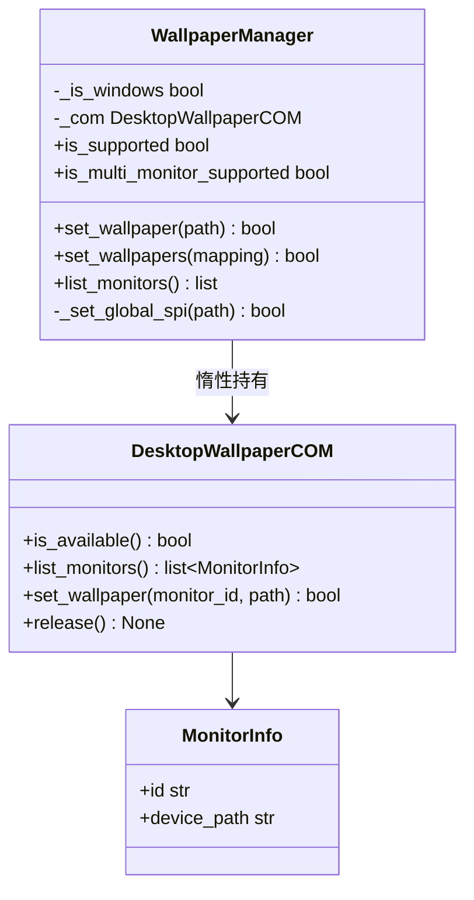
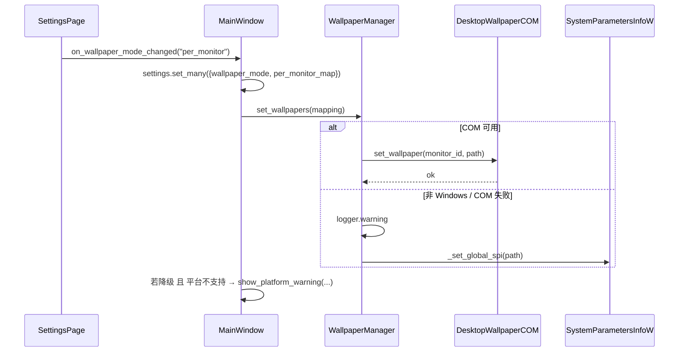
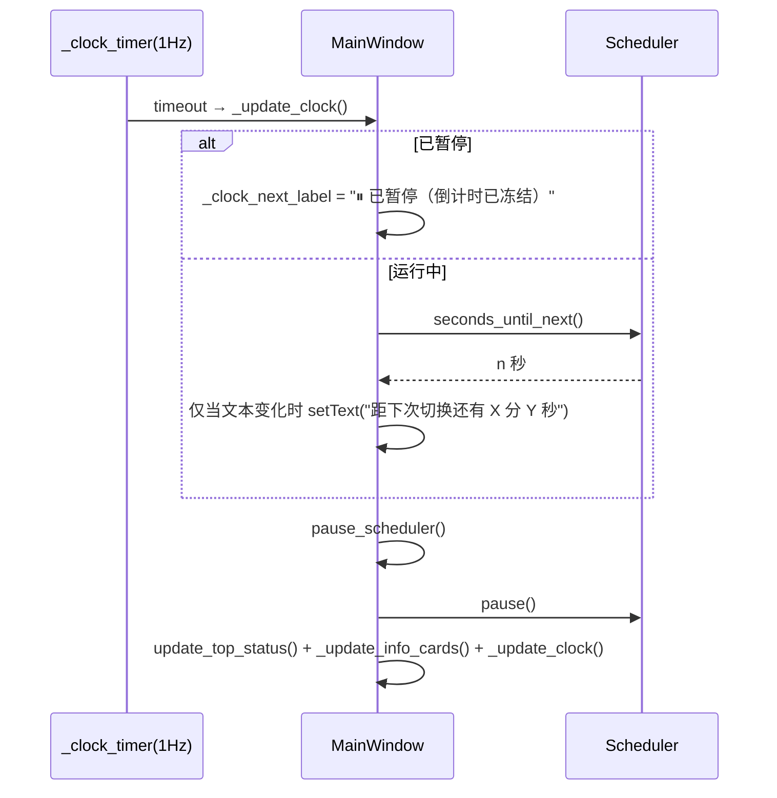
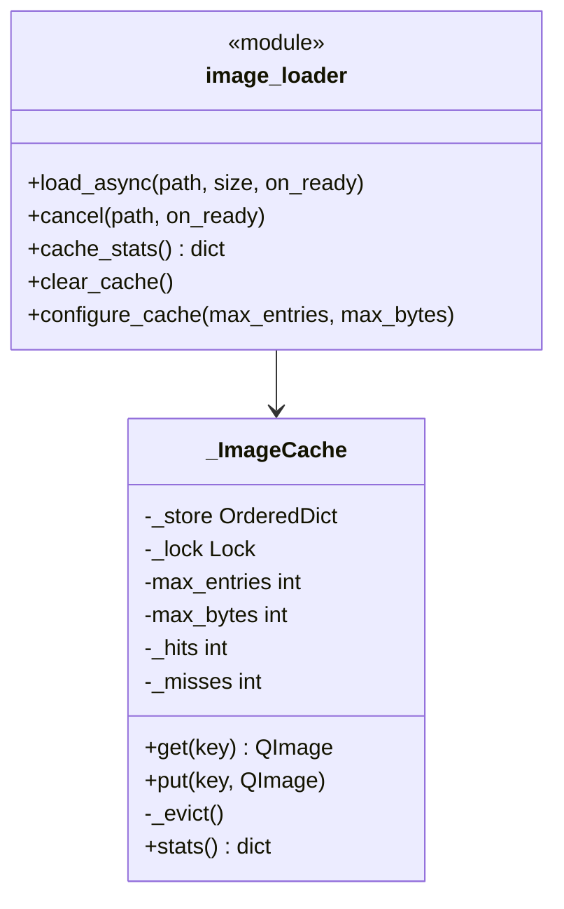
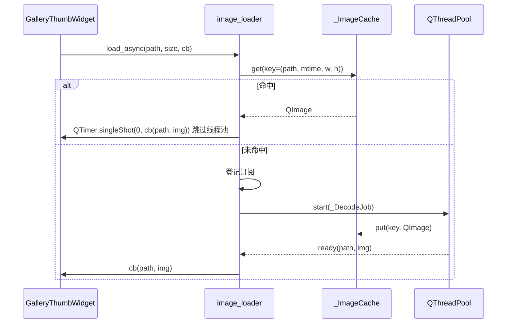
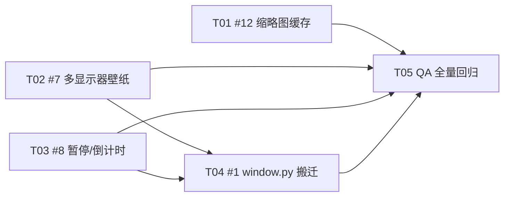

# Wallpace 优化批次 2 设计文档（#1 / #7 / #8 / #12）

- **作者**：高见远（架构师）
- **日期**：2026-09-25
- **基线**：`tests/` 全量 **172 passed / 1 skipped**（offscreen + 无真实 COM）
- **范围**：本文档仅为设计，**不改动 `src/` 与 `tests/` 任何文件**，不执行 git 写操作
- **禁止触碰**：`src/core/image_library.py`（工程师正在并行修复）

测试命令（后续所有任务沿用）：

```bash
cd /d/my_project/wallpace && QT_QPA_PLATFORM=offscreen \
  PYTHONPATH="$(pwd)/src" C:/Programs/Python/Python313/python.exe -m pytest tests/ -q
```

---

## 0. 概述

| 项 | 目标 | 新增文件 | 修改文件 | 新增依赖 | 优先级 |
|---|---|---|---|---|---|
| **#12** | 缩略图内存 LRU 缓存，避免重复解码 | 无 | `src/app/image_loader.py` | 无 | P1 |
| **#7** | 多显示器逐屏壁纸 + 优雅降级 | `src/core/desktop_wallpaper_com.py` | `wallpaper_manager.py`、`settings.py`、`settings_page.py`、`window.py` | 无（纯 `ctypes`） | P1 |
| **#8** | 暂停态 UI + 下次切换倒计时（低频刷新） | 无 | `scheduler.py`、`window.py` | 无 | P1 |
| **#1** | `window.py` 职责搬迁 1218 → <900 行 | `scan_controller.py`、`widgets/gallery_strip.py`、`settings_controller.py` | `window.py` | 无 | P1 |

**推荐执行顺序**：`#12 → #7 → #8 → #1 → QA`。
理由：三个功能性改动彼此低耦合，先落地稳定特性；`#1` 是结构重构，**放在最后**在“绿色测试基线 + 特性冻结”上做，避免重构后特性代码再搓一遍。

> ⚠️ **关键设计决策（贯穿全篇）**：`#1` **不抽取 StatusController**（时钟 / 顶栏 / 底栏 / 信息卡）。原因见 §1.6——它是 `#8` 的改动面，抽取会造成 `#1`/`#8` 强耦合。此为满足“并行不冲突”而做的有意取舍。

---

# Part A — 系统设计

## 1. #1 window.py 职责搬迁（1218 → <900 行）

### 1.1 搬迁决策总表（搬什么 / 不搬什么）

| 单元 | 去处 | 约行数 | 判据 | 决定 |
|---|---|---|---|---|
| `_ScanSignals` + `_ScanJob` + 扫描状态机 | `src/app/scan_controller.py` | ~90 | 自带 4 个状态字段（`_scan_running/_scan_pending/_scan_pool/_scan_signals`），是独立状态机，可单测 | ✅ 搬 |
| `_GalleryThumbWidget` + 横向缩略图条 + 懒加载状态机 | `src/app/widgets/gallery_strip.py` | ~145 | 自带 3 个状态字段 + 独立控件，可脱离 MainWindow 单测 | ✅ 搬 |
| 设置业务逻辑（7 个回调方法） | `src/app/settings_controller.py` | ~161 | 一组内聚的“设置→注册表/调度器/目录”副作用，非纯 UI | ✅ 搬 |
| `_setup_ui` / `_build_preview_page` / `_make_info_card` / `_build_clock_placeholder` / `_build_settings_page` | 原地 | — | 声明式装配，圈复杂度≈1，拆分只增加跳转成本（见 `architecture-review-2026-09-04.md` §2.2） | ❌ 不搬 |
| 时钟 / 顶栏 / 底栏 / 信息卡（StatusController） | 原地 | ~127 | 与 `#8` 改动面重叠；内聚性边际收益低 | ❌ 不搬（见 1.6） |
| `_handle_switch` / `_on_gallery_click` / `_update_preview` | 原地 | — | 壁纸切换业务编排，属 MainWindow 核心 | ❌ 不搬 |

### 1.2 行数核算（目标是否可达）

| 搬迁单元 | 当前行号区间 | 行数 |
|---|---|---|
| `_ScanSignals`+`_ScanJob` | 68–101 | 34 |
| `_GalleryThumbWidget` | 104–167 | 64 |
| 画廊区构建（scroll area） | 500–517 | 18 |
| `_refresh_gallery_thumbnails` / `_append_gallery_batch` / `_maybe_load_more_thumbnails` / `_highlight_current_gallery_item` | 1027–1079, 1145–1150 | 57 |
| 画廊常量与状态字段 | 189–191, 226–228 | 6 |
| 扫描状态机 `_start_async_scan` | 959–967 | 9 |
| 设置业务逻辑 | 671–831 | 161 |
| **小计（搬出）** | | **~349** |
| facade shim（保留同名入口，见 1.3） | | **~−14** |
| **净减少** | | **~335** |
| **搬迁后 window.py** | 1218 − 335 | **≈ 883 行 ✅** |

> 结论：**仅搬 Scan + Gallery 只能到 ~1010 行，达不到 <900**；必须叠加 SettingsController。此结论需 team-lead 确认（见 §待明确事项 Q1）。

### 1.3 耦合面与兼容契约（**本节是 `tests/test_window.py` 保持绿色的关键**）

搬迁后 MainWindow 必须**保留以下同名入口**（facade / 委托属性）。逐条对应现有测试：

| MainWindow 成员（必须保留） | 形态 | 转发目标 | 依赖它的测试 |
|---|---|---|---|
| `_scan_running` | **可读写 property** | `self._scan.running` | `_wait_for_scan`、`test_on_dirs_changed_respects_scan_guard`（**会赋值**，故须有 setter） |
| `_scan_pending` | **可读写 property** | `self._scan.pending` | `test_on_dirs_changed_respects_scan_guard` |
| `_start_async_scan()` | method | `self._scan.request_scan()` | `test_on_dirs_changed_triggers_async_scan`（**被 monkeypatch**，故 `_on_dirs_changed` 必须调用 `self._start_async_scan()` 而非 controller 方法） |
| `_on_dirs_changed()` | method（原地） | 调 `self._start_async_scan()` | `test_on_dirs_changed_*` |
| `_on_scan_finished(list)` | method（原地） | 连到 `self._scan.finished` | 扫描完成后 UI 更新路径 |
| `_gallery_layout` | **property** | `self._gallery_strip.layout()` | `test_gallery_thumbnails_refresh`、`test_second_thumbnail_rebuild_*`、`test_repeated_rebuild_*`（读 `.count()`） |
| `_refresh_gallery_thumbnails()` | method | `self._gallery_strip.reload(...)` | `test_repeated_rebuild_keeps_widget_count_stable` |
| `_empty_guide` / `_preview_card` / `_preview_page` / `_stacked` | 原地 | — | 多个测试 |
| `_add_directory` / `_remove_single_dir` / `_on_mode_changed` / `_on_autostart_toggled` / `_on_minimize_toggled` | method | `self._settings_ctrl.*` | `TestMainWindowSettings`、`TestDirectoryWatcherWiring`、`TestP0Regressions`、`TestMainWindowSettingsAutostart` |
| `_autostart_check` / `_minimize_check` | 原地 | — | `TestMainWindowSettingsAutostart` |
| `_watcher` / `_scheduler` / `_library` / `_settings` / `_wallpaper_manager` | 原地 | — | 多个测试 |
| `pause_scheduler` / `resume_scheduler` / `open_settings` / `closeEvent` / `quit_app` / `_force_quit` / `_tray` | 原地 | — | 多个测试 |

**兼容性推导举例**（逐条说明“为何仍然通过”）：

- `test_on_dirs_changed_respects_scan_guard`：测试设 `main_window._scan_running = True`（property setter 写入 `self._scan.running`），再 `_on_dirs_changed()` → `self._start_async_scan()` → `controller.request_scan()` 发现 `running=True` → 置 `pending=True`；测试读 `main_window._scan_pending` → property 返回 `True`。✅
- `test_on_dirs_changed_triggers_async_scan`：monkeypatch 了 `main_window._start_async_scan`，而 `_on_dirs_changed` 内部调用 `self._start_async_scan()`，走的是被替换的 lambda。✅
- `test_gallery_thumbnails_refresh`：`main_window._gallery_layout` 是 property，返回 `GalleryStrip` 内部 `QHBoxLayout`，其 `.count()` 与旧实现语义一致。✅
- `test_repeated_rebuild_keeps_widget_count_stable`：`_refresh_gallery_thumbnails()` 委托给 `strip.reload()`，`reload()` 内部沿用现有“`takeAt` 摘除 → `image_loader.cancel()` → `setParent(None)` → `deleteLater()`”清理逻辑（保持 P0-1 修复），widget 数稳定。✅

### 1.4 新增类接口

**`src/app/scan_controller.py`**

```python
class ScanController(QObject):
    started  = Signal()          # 扫描开始 → MainWindow._set_scan_ui_state(True)
    finished = Signal(list)      # 扫描完成 → MainWindow._on_scan_finished(list)

    def __init__(self, library: "ImageLibrary", parent=None) -> None: ...
    @property
    def running(self) -> bool: ...
    @running.setter
    def running(self, value: bool) -> None: ...      # 供测试/兼容
    @property
    def pending(self) -> bool: ...
    @pending.setter
    def pending(self, value: bool) -> None: ...
    def request_scan(self) -> None: ...              # 原 _start_async_scan 逻辑
    def shutdown(self, wait_ms: int = 1000) -> None: # closeEvent 调用：clear + waitForDone
```

内部：`_ScanSignals`、`_ScanJob`、`QThreadPool(self)`（`setMaxThreadCount(1)`，以 controller 为父）。

**`src/app/widgets/gallery_strip.py`**

```python
class GalleryThumbWidget(QLabel):
    clicked = Signal(str)
    def set_is_current(self, current: bool) -> None: ...

class GalleryStrip(QWidget):
    THUMB_BATCH = 10
    LOAD_AHEAD_PX = 240
    def __init__(self, on_select: Callable[[str], None], parent=None) -> None: ...
    def reload(self, paths: list[str], current_path: str) -> None: ...  # 原 _refresh_gallery_thumbnails
    def set_current(self, path: str) -> None: ...                      # 原 _highlight_current_gallery_item
    def layout(self) -> QHBoxLayout: ...                              # facade 暴露
```

**`src/app/settings_controller.py`**

```python
class SettingsController(QObject):
    def __init__(self, settings, library, scheduler, settings_page,
                 wallpaper_manager, scan_state: Callable[[], bool]) -> None: ...
    def on_autostart_toggled(self, checked: bool) -> None: ...
    def on_minimize_toggled(self, checked: bool) -> None: ...
    def add_directory(self) -> None: ...
    def remove_directory(self) -> None: ...
    def remove_single_dir(self, path: str) -> None: ...
    def on_mode_changed(self, text: str) -> None: ...
    def apply_interval(self) -> None: ...
```

> 注入 `scan_state`（读扫描中状态的回调）用于保留“扫描中禁止改目录/模式”的守卫；注入 `settings_page` 用于 `refresh()` / `set_controls_enabled()`。

### 1.5 时序图（搬迁后扫描流程）

```mermaid
sequenceDiagram
    participant MW as MainWindow
    participant SC as ScanController
    participant Pool as QThreadPool
    participant Job as _ScanJob
    participant Lib as ImageLibrary
    MW->>SC: request_scan()
    alt 已在扫描
        SC->>SC: pending = True
    else 空闲
        SC->>SC: running = True
        SC-->>MW: started()
        MW->>MW: _set_scan_ui_state(True)
        SC->>Pool: start(_ScanJob(lib, signals))
        Pool->>Job: run()
        Job->>Lib: scan()
        Lib-->>Job: list[str]
        Job-->>SC: signals.finished(list)
    end
    SC-->>MW: finished(list)
    MW->>MW: _on_scan_finished(list) → 更新预览/画廊/信息卡/底栏
    SC->>SC: running=False; if pending: request_scan()
```

### 1.6 为什么不抽 StatusController（与 #8 的耦合说明）

`#8` 需要修改 `_get_next_switch_text()` / `_update_clock()` / `_start_clock_timer()` / `update_top_status()`。若 `#1` 把这些搬进 `StatusController`，则 `#8` 必须改写同一批方法，两个任务产生结构级冲突。**保其在 MainWindow，`#1`/`#8` 均只触碰各自方法，互不重叠。**

### 1.7 风险点 / 回滚点 / 提交粒度

| 风险 | 说明 | 缓解 | 回滚点 |
|---|---|---|---|
| 隐藏耦合 | `_scan_running` 等被测试**赋值**，属性须可写 | 按 §1.3 提供可写 property | 单次提交可 revert |
| `_gallery_layout` 语义漂移 | 测试依赖 `.count()` | property 直返内部 layout，不复制 | 同上 |
| `_on_dirs_changed` 调错目标 | 必须调 `self._start_async_scan()` | 显式保留该实例方法 | 同上 |
| 线程池析构阻塞退出 | controller 持有 `QThreadPool` | `closeEvent` 调用 `scan.shutdown()` | 同上 |
| 越搬越碎 | 声明式代码被切碎 | §1.1 明确“不搬”清单 | — |

**建议提交粒度（3 次独立提交，每次跑全量测试）**：
1. `refactor(scan): 提取 ScanController` + facade → 跑测试；
2. `refactor(gallery): 提取 GalleryStrip` + facade → 跑测试；
3. `refactor(settings): 提取 SettingsController` + facade → 跑测试。

任一步测试变红即 `git revert` 该提交，粒度清晰。

### 1.8 依赖 #1 的测试策略

- **不改** `tests/test_window.py`（靠 facade 兼容）；作为重构正确性的“契约测试”。
- 可选新增 `tests/test_scan_controller.py`、`tests/test_gallery_strip.py`：脱离 MainWindow 单测，验证状态机（running/pending 合并补扫）与 `reload()` 幂等。
- 验收：全量 **172 passed / 1 skipped** 不变 + `window.py` < 900 行。

---

## 2. #7 多显示器独立壁纸

### 2.1 现状与难点

- 现状：`wallpaper_manager.set_wallpaper()` 调 `SystemParametersInfoW(SPI_SETDESKWALLPAPER, ...)`，**全局统一**设置。
- 难点：逐屏需 COM `IDesktopWallpaper`（`CLSID_DesktopWallpaper`），而 `ctypes` 手写 COM 涉及 **vtable 顺序、GUID、BSTR 释放** 三大坑；且必须在**非真实 COM 环境**（CI/offscreen）可测、失败必须优雅降级。

### 2.2 方案：`ctypes` 手写 COM，零新增依赖

> **不引入** `comtypes` / `pywin32` / `win32com`。理由：壁纸功能只用到 3 个 COM 方法，引入重量级包不值当，且与项目“纯 stdlib”现状冲突。

**GUID / 接口**
- `CLSID_DesktopWallpaper = {C2CF3110-460E-4FC1-B9D0-8A1C0C9CC4BD}`
- `IID_IDesktopWallpaper  = {B92B56A9-8B55-4E14-9A89-0199BBB6F93B}`
- vtable（IUnknown 后）：`SetWallpaper`(0) / `GetWallpaper` / `GetMonitorDevicePathAt` / `GetMonitorDevicePathCount` / …

**惰性初始化**：`WallpaperManager.__init__` **不触碰 COM**（保证 `WallpaperManager()` 在任意平台可构造——`test_wallpaper_manager.py` 会构造它）。COM 在首次调用 `is_multi_monitor_supported()` / `set_wallpapers()` 时才惰性 `CoCreateInstance`。

### 2.3 类图



### 2.4 接口（`src/core/desktop_wallpaper_com.py`）

```python
class DesktopWallpaperCOM:
    def is_available(self) -> bool: ...
    # 非 Windows / CoCreateInstance 失败 / 任意异常 → False（绝不抛）
    def list_monitors(self) -> list[MonitorInfo]: ...
    # 内部 GetMonitorDevicePathCount + GetMonitorDevicePathAt；失败返回 []
    def set_wallpaper(self, monitor_id: str, image_path: str) -> bool: ...
    # monitor_id == "" 表示全部显示器（IDesktopWallpaper 语义）
    def release(self) -> None: ...   # Release + CoUninitialize
```

`WallpaperManager` 扩展（**保持 `set_wallpaper` 签名与行为不变**）：

```python
def set_wallpapers(self, mapping: dict[str, str]) -> bool:
    """映射 {monitor_id: path}；key "" 表示全部。返回是否全部成功。"""
def list_monitors(self) -> list[dict]: ...
@property
def is_multi_monitor_supported(self) -> bool: ...
```

### 2.5 优雅降级策略

| 条件 | 行为 |
|---|---|
| 非 Windows | `is_supported=False`（不变）；启动时 `show_platform_warning`（**复用现有机制**） |
| Windows 但 `CoCreateInstance` 失败 | `logger.warning`；`is_multi_monitor_supported=False`；逐屏开关置灰；统一模式走原 SPI |
| `SetWallpaper(monitor)` 返回失败/异常 | `logger.warning`；**回退整屏 SPI 设置**；返回 `False` |
| 显示器数 < 2 | 逐屏模式无意义 → UI 隐藏该开关 |

### 2.6 配置（`settings.py`）

`DEFAULT_CONFIG` 新增（`validate()` **不需要**为它们加规则——未知字段被保留；但为可读性补两条）：

```python
"wallpaper_mode": "unified",   # "unified" | "per_monitor"
"per_monitor_map": {},         # {monitor_id: image_path}
```

### 2.7 时序图



### 2.8 测试策略（mock 边界）

- **可测边界 1**：`DesktopWallpaperCOM.is_available()` — CI/offscreen 下天然返回 `False`，驱动降级路径。
- **可测边界 2**：monkeypatch `ctypes.windll.user32.SystemParametersInfoW`（现有测试风格）验证降级后仍调用 SPI。
- **可测边界 3**：monkeypatch `DesktopWallpaperCOM` 的方法（`list_monitors`/`set_wallpaper`）验证逐屏分支与失败回退，**不依赖真实 COM**。
- **纯逻辑单测**：`{monitor_id: path}` → COM 调用序列、显示器数<2 的裁剪、异常回退。
- **现有测试为何仍通过**：`is_supported` 语义不变；`set_wallpaper(不存在路径)` 仍返回 `False`；`verify_set` 未改动；`__init__` 不触碰 COM。→ `test_wallpaper_manager.py` 全绿。

---

## 3. #8 暂停 / 倒计时显示

### 3.1 现状分析

- `pause_scheduler()` / `resume_scheduler()` 仅更新托盘（`self._tray.update_pause_status`）。
- `_get_next_switch_text()` 已存在，仅对 daily 模式给出静态文本；interval 模式只有“每 X 分钟”静态串。
- 1 Hz `_clock_timer`（`_start_clock_timer`）驱动 `_update_clock()`，每秒更新 3 个标签。

### 3.2 方案：扩展（不新增方法）

**判定：扩展现有 `_get_next_switch_text()`，不新建函数。** 同时给 `Scheduler` 补一个**统一取“剩余秒数”**的只读 API（daily / interval 通吃）。

**`src/core/scheduler.py` 新增**：

```python
def seconds_until_next(self) -> Optional[int]:
    """距下次自动切换的剩余秒数；未运行 / 已暂停 / 无定时器 → None。"""
    if not self._is_running or self._is_paused or self._timer is None:
        return None
    ms = self._timer.remainingTime()          # 单次与重复 QTimer 均可用
    return max(0, ms // 1000) if ms >= 0 else None
```

**`window.py` 的 `_get_next_switch_text()` 扩展**：

```python
if scheduler is None:            return "调度器未启动"
if not scheduler.is_active:      return "⏸ 已暂停（倒计时已冻结）"     # 暂停态
sec = scheduler.seconds_until_next()
if mode == "daily_random":       return f"距下次切换还有 {h}小时{m}分{s}秒"
if mode == "interval_minutes":   return f"距下次切换还有 {m}分{s}秒"
if mode == "manual":             return "手动模式，不会自动切换"
```

**`pause_scheduler()` / `resume_scheduler()` 补 UI 立即刷新**：

```python
def pause_scheduler(self):
    self._scheduler.pause(); self._tray.update_pause_status(True)
    self.update_top_status(); self._update_info_cards(); self._update_clock()
```

### 3.3 低频刷新与 CPU 控制（硬要求）

| 措施 | 说明 |
|---|---|
| **复用 `_clock_timer`，不新增定时器** | 唯一 1 Hz 时钟，符合“不引入高频重绘” |
| **1 Hz 而非更高** | 秒级倒计时 1 Hz 足够；不做到 10 Hz 平滑动画 |
| **文本变化才 `setText`** | 新增 `_last_next_text` 缓存，`_update_clock` 内比对后再 `setText`，避免无效重绘 |
| **暂停即冻结** | `seconds_until_next()` 暂停返回 `None` → 文本变“⏸ 已暂停”，不再每秒算 delta |
| （可选，P1-7）**非时钟页降频/停表** | 评审建议的省电优化；本批**不做**，避免扩大改动面（见 §待明确 Q4） |

### 3.4 时序图



### 3.5 测试

- `tests/test_scheduler.py` 新增：interval 模式 `start()` 后 `seconds_until_next()` 为 `int` 且 `0 ≤ v ≤ interval*60`；`pause()` 后为 `None`。
- `tests/test_window.py` 新增：`pause_scheduler()` 后 `_get_next_switch_text()` 含“已暂停”；运行态含“分”。
- **现有测试为何仍通过**：无测试断言 `_get_next_switch_text` 的具体串；新增 API 不改变既有行为。

---

## 4. #12 缩略图内存 LRU 缓存

### 4.1 关键论证：缓存 QImage 而非 QPixmap

> `QPixmap` **只能在 GUI 主线程构造与使用**（依赖 `QGuiApplication` 的 backing store）。而解码发生在 `QThreadPool` 工作线程 → **绝不能缓存 `QPixmap`**。
> `QImage` 是 CPU 侧隐式共享位图，**跨线程构造/读取安全**，且现有代码本就在工作线程产出 `QImage`、由 `_on_image_ready` 在 GUI 线程转为 `QPixmap`。→ **缓存 `QImage`**，`QPixmap` 转换仍留在 GUI 线程。

### 4.2 设计方案

| 维度 | 决策 |
|---|---|
| **缓存键** | `(str(resolved_path), st_mtime_ns, size.width(), size.height())`；`mtime_ns` 感知文件更新，`size` 区分缩略图/大图 |
| **容量策略** | 双上限：`max_entries`（默认 512）**且** `max_bytes`（默认 128 MB）；`bytes ≈ image.sizeInBytes()` |
| **淘汰策略** | LRU（`OrderedDict`：命中 `move_to_end`；`popitem(last=False)` 淘汰） |
| **线程安全** | `threading.Lock` 保护（与现有 `_subscribers_lock` 风格一致） |
| **命中路径** | **跳过 `QThreadPool`**，直接投递结果；为不破坏异步语义，用 `QTimer.singleShot(0, ...)` 回调（避免在 `load_async` 内重入调用方） |
| **未命中** | 登记订阅 → `_DecodeJob` → 解码成功在**工作线程** `cache.put(key, image)` → 经信号回主线程 `_dispatch` |

**内存上界估算**：

| 图种 | 尺寸 | 单张 QImage | 128 MB 约可容纳 |
|---|---|---|---|
| 预览页大图 | 900×600 | ~2.16 MB | ~59 张 |
| 画廊 tile | 160×120 | ~77 KB | ~1660 张 |
| 预览页横条 | 200×160 | ~128 KB | ~1000 张 |

→ 上限受 `max_bytes` 主导，预览大图是主要占用方；`max_entries=512` 兜底防止海量小图条目膨胀。

### 4.3 类图



### 4.4 接口

```python
def configure_cache(max_entries: int = 512, max_bytes: int = 128 * 1024 * 1024) -> None: ...
def cache_stats() -> dict:   # {"entries","bytes","hits","misses"}
def clear_cache() -> None: ...
```

`load_async` 内部改造（伪码）：

```python
key = _make_key(path, target_size)
hit = _cache.get(key)
if hit is not None:
    if on_ready: QTimer.singleShot(0, lambda: on_ready(path, hit))
    _broadcast_dispatch(path, hit)          # 广播者同样收到（保持兼容）
    return
# 未命中：原逻辑（登记订阅 + 投递 _DecodeJob）；解码成功时 _cache.put(key, image)
```

### 4.5 时序图



### 4.6 测试（mock 边界）

- 新增用例：同一 `path+size` 二次 `load_async` → 命中，`cache_stats()["hits"]==1`，且**不再产生新线程池任务**。
- 淘汰：`configure_cache(max_entries=2)` 后插入 3 张 → `entries==2`，最旧被淘汰。
- 类型：缓存项 `isinstance(x, QImage)`（**断言不是 QPixmap**）。
- 失效：改写文件 → `mtime_ns` 变化 → 新 key，重新解码。
- **现有测试为何仍通过**：
  - `test_failed_decode_discards_subscription`：不存在的文件不会进缓存，解码失败仍 `_discard`，`pending_count()==0`。✅
  - `test_cancel_prevents_callback`：用例每次独立 path，缓存未预热，仍走解码路径。✅
  - `test_multiple_subscribers_same_path`：单次调用、未命中，两订阅者均触发。✅
  - `test_disconnect_is_real_and_idempotent`：第二次 `load_async` 命中缓存，但设计上**仍向广播列表派发**，行为不变。✅
- **注意**：测试间共享模块级缓存可能相互污染 → 每个用例建议 `clear_cache()`（autouse fixture）。

---

# Part B — 任务分解

## 5. 依赖包清单

```
- 无新增第三方依赖
- 复用现有：PySide6（Qt）、standard library（ctypes / threading / collections / datetime）、pytest
- 明确不引入：comtypes、pywin32、Pillow
```

## 6. 任务列表（按依赖排序）

> 说明：本批为**棕地增量改造**，无“项目基础设施”新建任务（配置文件/入口均已存在，且禁止改动无关文件）。故“第一个任务”取**依赖最少、影响面最小**的 `#12`。硬上限 5 个任务已满足；“每任务 ≥3 文件”为绿地启发式，棕地单模块改动（T01）为 2 文件，属合理偏差并已注明。

| Task ID | 名称 | 源文件 | 依赖 | 角色 | 优先级 |
|---|---|---|---|---|---|
| **T01** | 缩略图内存 LRU 缓存（#12） | `src/app/image_loader.py`、`tests/test_image_loader.py`（2 文件，单模块改动） | — | engineer | P1 |
| **T02** | 多显示器逐屏壁纸 + 降级（#7） | `src/core/desktop_wallpaper_com.py`(新)、`src/core/wallpaper_manager.py`、`src/core/settings.py`、`src/app/pages/settings_page.py`、`src/app/window.py`、`tests/test_wallpaper_manager.py`、`tests/test_settings.py` | — | engineer | P1 |
| **T03** | 暂停态 UI + 倒计时（#8） | `src/core/scheduler.py`、`src/app/window.py`、`tests/test_scheduler.py`、`tests/test_window.py` | — | engineer | P1 |
| **T04** | window.py 职责搬迁（#1） | `src/app/scan_controller.py`(新)、`src/app/widgets/gallery_strip.py`(新)、`src/app/settings_controller.py`(新)、`src/app/window.py`、`tests/test_scan_controller.py`(新，可选)、`tests/test_gallery_strip.py`(新，可选) | **T02, T03** | engineer | P1 |
| **T05** | QA 全量回归 + 新功能验证 | `tests/test_*.py`（新增/扩用例）；无 src 改动 | **T01, T02, T03, T04** | qa | P0 |

**T04 依赖 T02/T03 的原因**：T04 大改 `window.py`，须等 `#7`/`#8` 对 `window.py` 的改动落定后再重构，避免重构后重搓特性代码。

## 7. 共享约定（Shared Knowledge）

- **测试基线**：每完成一个任务，`tests/` 必须保持 **≥172 passed / 1 skipped**；新用例另行计数。
- **禁止改动**：`src/core/image_library.py`。
- **平台/能力检测统一走 `is_supported` + `show_platform_warning`**；任何平台/COM/IO 缺失一律**降级 + 记日志**，绝不抛异常阻断启动。
- **回调线程契约**：所有 `on_ready(path, image)` 回调在 **GUI 主线程**执行；缓存命中经 `QTimer.singleShot(0, ...)` 投递。
- **缓存对象类型**：只缓存 `QImage`，`QPixmap` 转换留在 GUI 线程。
- **空值/失败语义**：新 API 失败返回 `False`/`None`/`[]`（不用异常表达“正常失败”）。
- **配置扩展**：新键加入 `DEFAULT_CONFIG`；未知键由 `_merge_with_defaults` 保留，不改动 `validate` 的既有规则语义。
- **重绘节俭**：`setText` 前比对旧值。
- **日志**：`logging.getLogger(__name__)`；降级用 `warning`，失败用 `error`。
- **命名兼容**：`#1` 搬迁后严格遵守 §1.3 的 facade 契约；否则 `tests/test_window.py` 必红。

## 8. 任务依赖图



---

## 9. 待明确事项（需 team-lead / 用户拍板）

| # | 事项 | 我的建议 | 影响 |
|---|---|---|---|
| **Q1** | `#1` 目标 `<900` 行是否硬指标？ | 按 §1.2 必须叠加 SettingsController 才达标（~883）；若追求“最小风险”，可只搬 Scan+Gallery（~1010） | 决定 T04 是否含 SettingsController |
| **Q2** | 逐屏模式（`#7`）用户如何为每屏指定图片？ | 最小实现：**每屏随机分配不同图**（无需逐屏选图 UI）；进阶再做逐屏选择器 | 决定 T02 UI 工作量 |
| **Q3** | interval 模式倒计时需新增 `Scheduler.seconds_until_next()` | 采纳（daily/interval 统一 API） | 决定 T03 是否改 core |
| **Q4** | 是否顺带修 P1-7（时钟定时器常驻耗电）？ | 本批**不做**，只保 1 Hz + 文本变化去重；避免扩大 `#8` 改动面 | 影响续航与改动范围 |
| **Q5** | `#12` 缓存上限参数 | `max_entries=512` / `max_bytes=128MB`（可运行时 `configure_cache` 调） | 内存占用 |
| **Q6** | 预览大图（900×600）是否也缓存？ | 缓存（命中收益最大），但受 `max_bytes` 约束 | 内存 vs 命中率 |

---

## 10. 最高风险项 & 明确“不值得做”的部分（给主理人速览）

**最高风险**
1. **`#1` 与 `tests/test_window.py` 的隐藏耦合**（`_scan_running` 可写属性、`_start_async_scan` 被 monkeypatch、`_gallery_layout.count()`）→ 靠 §1.3 facade 契约化解，是本批最脆的一环。
2. **`#7` 的 `ctypes` 手写 COM** ABI 敏感（vtable 顺序 / BSTR 释放 / GUID），真实 COM 无法在 offscreen CI 验证 → 靠“惰性初始化 + 全路径 try/except + 纯逻辑单测”兜底。
3. **`#8` `QTimer.remainingTime()` 对重复定时器的语义**需实测确认。

**不值得做（避免过度设计）**
- 不拆 `_setup_ui` / `_build_preview_page` / `_make_info_card`（声明式装配，拆分只增跳转）。
- 不抽 `StatusController`（与 `#8` 冲突、内聚收益边际）。
- 不引入 `comtypes`/`pywin32`。
- 不缓存 `QPixmap`（线程亲和性硬约束）。
- 本批不做 `GalleryPage` 全虚拟化（超出 4 项范围）。
